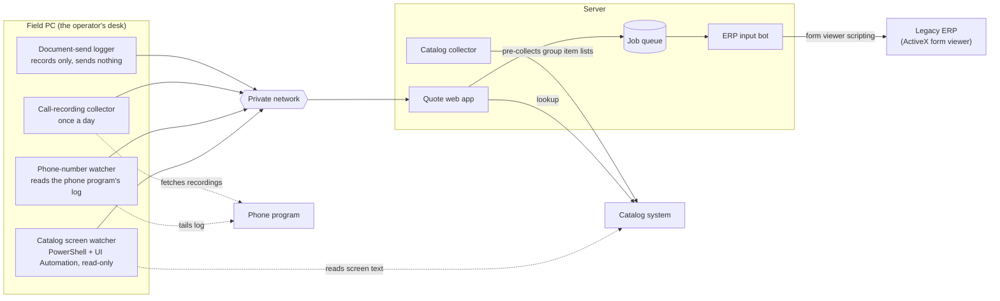

# legacy-erp-automation

Old business systems built for Internet Explorer and ActiveX still run many offices, and replacing them is rarely an option. This repository shows another way: leave the old system exactly as it is, put a rule-based bot on top of it, and let the bot do the typing while a person keeps every decision that matters.

The system described here is one that was built and used this way. A phone call comes in, the operator looks something up in an old catalog site, a quote web app builds the lines, a bot types them into the legacy ERP, and then reads the document back to check it. The old systems themselves were not modified or replaced.

The bot follows fixed rules and uses no language model at run time. Everything it can do is listed in advance, so every action can be checked before it happens, and it never improvises: what the rules do not cover, it hands to a person.

Three ideas carry it:

1. **Wrap, do not replace.** The bot drives the ERP through the scripting object that its own form viewer already offers. The catalog site is only read. A small watcher on the operator's PC reads the screen and touches nothing.
2. **Make the dangerous things impossible, not avoided.** The bot has an allow-list of screens and form functions. Printing, deleting and final confirmation are not on it, so there is no way to call them. Saving needs two separate locks.
3. **Do not trust the old system's own messages.** After saving, the bot reads the document back and compares it with what was meant. Anything unexpected stops the job and hands it to a person.

The design is about those safeguards. Everything you can run in this repository is shown on invented fake systems.

> What is here: the concept specs ([docs/concepts](docs/concepts/)), six concept modules in `app/modules`, the syncs that connect them in `app/syncs`, fakes for every outside system in `app/adapters`, and a scenario demo in `demo/`. Where a document below says "described, not implemented here", it means exactly that.

## Architecture



Solid arrows are data the system sends; dotted arrows are places where a watcher only reads. Details per component: [docs/architecture.md](docs/architecture.md).

## Flow

1. The phone rings. The phone-number watcher puts the caller number on the server (about 4 seconds later).
2. The operator looks something up in the catalog system.
3. The screen watcher notices the identifier on the operator's screen and attaches it to the current call on the server.
4. The quote web app builds the quote lines from it.
5. The operator presses "Send". The quote becomes a job in the queue.
6. The bot runs the job as a dry run, or saves it if saving is switched on for this job and this site.
7. The bot reads the document list back from the ERP and compares it with what was meant to be written.
8. If anything differs, or anything unexpected happened, the job goes to a person. There is no automatic retry.
9. In the evening a person corrects the final version, and the difference between the suggestion and the final version is recorded.
10. The recorded differences feed a weekly improvement round.

## Design principles

| Principle | What it means here |
|---|---|
| A person keeps every decision that matters | Prices come only from a person. Printing, deleting and the final confirmation are done by a person; the bot has no way to call them. |
| Things that must not happen are impossible, not avoided | An allow-list (screens, form functions) decides what exists for the bot. A function not on the list cannot be called, so there is nothing to forget to avoid. Saving needs two separate locks. |
| Do not trust the target's own messages | A "saved" notice proves nothing. After saving, the bot reads the document back and compares it with the intent. |
| Stop instead of guessing | An unknown dialog, a denied action or a mismatch stops the job and hands it to a person. One automatic re-login at most, so an account is never locked out by retries. |
| Every replaceable piece sits behind a flag | New versions of a module run behind a feature flag that is off by default. If the new version fails, the old one is still there. |

The safeguards are described one by one in [docs/bot-safety.md](docs/bot-safety.md).

## Why not replace it, or record keystrokes?

- **Replace the ERP:** it belongs to someone else and cannot be changed. The automation has to live with it as it is.
- **Keyboard and screen-coordinate macros:** this was the first version. It needs the window in front, a fixed screen resolution and measured coordinates. It was deleted once the scripting route worked.
- **What is used instead:** the form viewer's own scripting interface, over COM. The bot calls the same form functions a person's typing triggers, reads the form's data as XML, and works while the browser is behind other windows or minimized. How that works, and where it bites: [docs/legacy-viewer.md](docs/legacy-viewer.md).

## How the repo is built

Three methods, each with a single job:

- **Concept design.** Functionality is split into independent concepts, each with a purpose, state, actions and an operational principle, connected only by declarative synchronizations. The specs come before the code: [Quote](docs/concepts/Quote.md), [JobQueue](docs/concepts/JobQueue.md), [ActionPolicy](docs/concepts/ActionPolicy.md), [Verification](docs/concepts/Verification.md), [Call](docs/concepts/Call.md), [Sighting](docs/concepts/Sighting.md), the [syncs](docs/concepts/syncs.md), and the list of [volatile decisions](docs/concepts/volatile.md) with the one place each is hidden.
- **Let It Slop.** Each folder in `app/modules` is one isolated, replaceable module. Modules never import each other; they meet only in `app/syncs`. When requirements change materially, a new version is written next to the old one and switched on with a flag, instead of refactoring the old one.
- **TCR** (test && commit || revert). In the author's local workflow, a green test run is committed automatically and a red one is reverted automatically. The tooling for this is not part of the repository.

Outside systems are reached only through ports in `app/adapters` ([ports.py](app/adapters/ports.py), [adapter list](app/adapters/README.md)). Policy values (readings needed, quiet periods, restart limits) live in [app/settings.py](app/settings.py).

## How to run it

Needs Python 3.11 or newer. The code itself uses only the standard library; the tests need pytest. Run everything from the repository root.

Windows:

```text
py -3 -m venv .venv
.venv\Scripts\python -m pip install -e ".[test]"
.venv\Scripts\python -m pytest -q
.venv\Scripts\python -m demo
```

macOS and Linux:

```text
python3 -m venv .venv
.venv/bin/python -m pip install -e ".[test]"
.venv/bin/python -m pytest -q
.venv/bin/python -m demo
```

The demo needs no real waiting and prints the same output every run. It runs six scenarios against the fakes and prints each step: a dry run, a save that is read back and matches, an unknown dialog that stops the bot, an ERP that says "Saved." and did not save it, a forbidden function and a single save lock that are refused, and an adapter error with a duplicate send and a STOP. It ends with a table of the final job state per scenario and exits with 0 only if every scenario ended as intended.

An excerpt from scenario 4, where the fake ERP shows "Saved." but stores a changed quantity:

```text
=== Scenario 4: The ERP lies about saving ===
  save_mode='lie_altered': the viewer will say 'Saved.' whatever it stores.
    [RunNextJob] called (screen=QuoteScreen, fn=save_form, saving=True)
    [RunNextJob] dialog accepted (text=Save this form?)
    [RunNextJob] dialog accepted (text=Saved.)
    [RunNextJob] opened (screen=ListScreen)
    [RunNextJob] dialog accepted (text=Loading complete.)
    [RunNextJob] called (screen=ListScreen, fn=refresh_list, saving=False)
    [RunNextJob] dialog accepted (text=Loading complete.)
    [SavedJobIsReadBack] document read back (job=Q1, lines=2)
    [VerificationFinishesJob] job finished (job=Q1, state=needs_human, detail=qty P-100: 2 != 3)
  The ERP holds Q1: P-100 x3 @ 12.50; P-101 x2 (ERP price)
```

The ERP said "Saved.", the read back found 3 where 2 were typed, and the job went to a person instead of being marked done.

## Has it been used for real?

Yes. The system this repository describes runs on a real server for a real office. It is in use today and is still being improved and extended. These are the facts about it, with what each one means:

| What happened | Result | Why it matters |
|---|---|---|
| First real save and first real use | Done | Since then the bot has typed into the live ERP, not into a test copy. |
| Real-environment test table: 34 steps run on the real server | 30 recorded as passed (one of them conditionally), 1 on hold, 1 in progress, 2 not run | The steps that are not finished are written down, not left out. Format: [docs/operations.md](docs/operations.md). |
| Four catalog windows looked things up at the same time | 224 lookups, none mixed up with another; 3.5 to 3.8 times faster than one window at a time | Speed did not cost correctness. |
| Screen watcher checked against 6 days of recorded screen readings | 65 results matched what was recorded, 0 errors | The "same reading twice in a row" rule behaves on real screen text. See [docs/screen-watcher.md](docs/screen-watcher.md). |

How to read this table: these results come from the real system, which is not published. You cannot re-run them from this repository, so treat them as statements by the author, not as proof. What you can check yourself is the next section: the safeguards, run against fakes.

## What the fakes prove and what they cannot

Everything that can be run in this repository is invented: a fake form viewer, a fake catalog, a scripted phone and a scripted screen. They imitate the shape of the problem (dialogs that pop up, a save message that can lie, screen text that flickers while it loads), not the behaviour of any real product.

- Passing tests show that the safeguards behave as designed against those fakes. They say nothing about any real system.
- The real ERP adapter, which drives the scripting interface of an ActiveX form viewer through COM, is described in [docs/legacy-viewer.md](docs/legacy-viewer.md) only. It is not included in this repository.
- The real screen watcher, phone-number watcher, recording collector and send logger are likewise described, not implemented here.

## More documents

| Document | Contents |
|---|---|
| [docs/architecture.md](docs/architecture.md) | Components, data flow, where each outside system hides, concept/sync split |
| [docs/bot-safety.md](docs/bot-safety.md) | The safeguards one by one |
| [docs/legacy-viewer.md](docs/legacy-viewer.md) | Driving the legacy ActiveX form viewer over COM: attaching, why not key presses, pitfalls |
| [docs/screen-watcher.md](docs/screen-watcher.md) | Reading the operator's screen without touching it |
| [docs/operations.md](docs/operations.md) | Flags, rollout, updates, self-healing, real-environment test table |
| [docs/decisions.md](docs/decisions.md) | Decision log |

## License

MIT, see [LICENSE](LICENSE).
