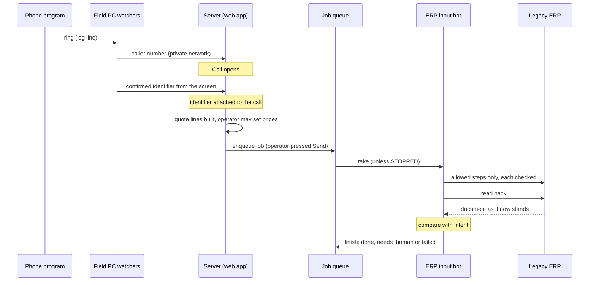

# Architecture

Overview and diagram: [README](../README.md). This page lists the components, follows the data, shows where each outside system is hidden, and explains how the design is split into concepts and syncs.

## Components

| Component | Runs on | What it does | How |
|---|---|---|---|
| Quote web app | Server | Looks up the catalog, builds quote lines, puts them in the bot's queue | Python web server; reads catalog pages through browser automation (DOM); a pool of up to 4 windows, 1.5 s apart |
| ERP input bot | Server | Takes jobs from the queue, enters them into the legacy ERP and saves them | Scripting object of the ActiveX form viewer, driven through COM: call a form function, set a value, read the screen data as XML ([legacy-viewer.md](legacy-viewer.md)) |
| Catalog screen watcher | Field PC | Reads the text of the catalog screen the operator is looking at and sends it to the server | PowerShell + UI Automation, read-only ([screen-watcher.md](screen-watcher.md)) |
| Catalog collector | Server | Collects the item lists of groups in advance | Browser automation; reads the rows of a grid object, including hidden columns |
| Phone-number watcher | Field PC | Sends the caller number to the server | PowerShell; follows the phone program's log file, opened in shared mode, every 0.3 s |
| Call-recording collector | Field PC | Fetches the day's call recordings once a day | Win32 messages, to a fixed list of 5 allowed controls only |
| Document-send logger | Field PC | Notices that a document was saved and records it. It records only; it sends nothing | Follows the viewer's log file and checks whether the user was typing |
| Operations scripts | Server and field PC | Deploy, update, self-healing, restore | PowerShell, scheduled tasks ([operations.md](operations.md)) |

In this repository only the server-side logic is modelled, and only against fakes. The real field-PC components and the real ERP adapter are described, not implemented here.

## Data flow

Three properties of the flow:

- **Watchers push to the server.** The field PC reads and reports (screen text, caller number, recordings, send log); the decisions are made on the server.
- **The queue is the only road to the ERP.** A quote becomes a job; the bot takes one job at a time. See [JobQueue](concepts/JobQueue.md).
- **The end of a job is decided by reading back, not by the ERP's own message.** See [Verification](concepts/Verification.md).

## Where each outside system hides

Every outside system sits behind a port with a fake next to it. Concepts never see ports; only `app/syncs` and entry points do. The full table, with the evidence that each thing will change, is [concepts/volatile.md](concepts/volatile.md).

| Outside system | Port (`app/adapters/ports.py`) | Fake (see `app/adapters/README.md`) | Chosen by |
|---|---|---|---|
| Legacy ERP's form viewer | `ErpViewer` | `FakeErpViewer` | `LEA_ERP=fake` |
| How one quote is typed into that ERP | `ErpRecipe` | `FakeRecipe` | with `LEA_ERP` |
| Catalog system | `Catalog` | `FakeCatalog` | `LEA_CATALOG=fake` |
| Phone program's log | `PhoneLog` | `ScriptedPhone` | `LEA_PHONE=fake` |
| Screen text on the field PC | `ScreenText` | `ScriptedScreen` | `LEA_SCREEN=fake` |

The ERP's document format on read-back is hidden in the ERP adapter too: `read_back` turns the outside format into a plain `Document` (`header` plus `lines`), so `Verification` never sees the outside format.

The fakes are invented. They say nothing about any real product ([README](../README.md#what-the-fakes-prove-and-what-they-cannot)).

## Concepts and syncs

| Layer | Folder | Rule |
|---|---|---|
| Concepts (modules) | `app/modules/<name>_v<N>` | Independent. Own state, own actions, own tests. Never import each other and never import `app/adapters`. |
| Syncs | `app/syncs` | The only place where concepts meet. One function per sync, no business logic beyond the sync's `where` condition. |
| Adapters | `app/adapters` | The only place that talks to an outside system. |
| Settings and flags | `app/settings.py`, `app/flags.py` | Policy values in one place. Flags are read only in `app/syncs`. |

| Concept | Purpose in one line |
|---|---|
| [Quote](concepts/Quote.md) | Build a quote line by line; only a person sets a price. |
| [JobQueue](concepts/JobQueue.md) | Hand work to the bot one job at a time, with a stop switch, never the same job twice. |
| [ActionPolicy](concepts/ActionPolicy.md) | Say before the bot acts whether it is allowed; unexpected means stop. |
| [Verification](concepts/Verification.md) | Decide whether the ERP holds what was meant, without trusting its message. |
| [Call](concepts/Call.md) | Track incoming calls so that what is looked up lands next to the call. |
| [Sighting](concepts/Sighting.md) | Decide that an identifier is really on screen, from text that flickers. |

The [syncs](concepts/syncs.md) connect them. For example, a sent quote becomes a job (`SentQuoteBecomesJob`), the next job runs through the allow-list (`RunNextJob`), a saved job is read back (`SavedJobIsReadBack`), and the comparison result finishes the job (`VerificationFinishesJob`). No sync retries a job. A person re-sends, which is a new job id.

Why the split matters in practice: a concept can be replaced by a new version behind a flag without touching any other concept, because the only code that knows two concepts is one short sync function.
