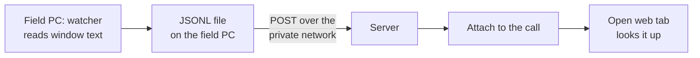

# Screen watcher

**Problem:** while a call is going on, the operator looks something up in the catalog system. Nobody should have to retype the identifier they are already looking at, and nothing on the operator's PC may change or slow down.

**Answer:** a small resident program on the field PC reads the text of the catalog window, decides carefully that an identifier is really on screen, and reports it to the server. The server attaches it to the current call, and a web tab that is already open looks it up.

This page describes the real watcher (described, not implemented here) and maps it to the parts of this repository that model it against a fake: the `ScreenText` port, the `ScriptedScreen` fake, and the concepts [Sighting](concepts/Sighting.md) and [Call](concepts/Call.md).

## What the real watcher does

| Rule | Why |
|---|---|
| Runs on the field PC as PowerShell + UI Automation | The text is on that PC's screen; nothing else can see it without touching the catalog's traffic (see the alternatives below). |
| Read-only: no clicks, no typing, no requests of its own to the catalog | The operator's work must not be disturbed, and the watcher must not be able to change anything. |
| Once a second it looks only at window titles | Cheap, and it needs no access to window contents. |
| Only a window whose title matches is read with UI Automation | Everything else stays unread. |
| Login screens are never read | Nothing the watcher needs is there, and it is where secrets are typed. |

## From reading to confirmed identifier

Screen text flickers while a page loads: half-drawn, the previous page, several identifiers at once. A single reading is therefore never trusted.

| Rule | Effect | Where |
|---|---|---|
| The same result must be seen **2 times in a row** | One-off flicker is ignored. | `SIGHTING_NEEDED = 2` in [app/settings.py](../app/settings.py) |
| The same identifier is not reported again for **60 s** | The operator staying on a page does not produce a stream of duplicates. | `SIGHTING_QUIET` (60 s) |
| Several candidates and none selected: **send nothing**, and the run of equal readings starts over | A wrong guess is worse than no report. If one candidate is marked as selected on screen, that one is the candidate. | `Sighting.observe` returns `Ambiguous` |
| No candidate: nothing sent, the run starts over | | `Sighting.observe` returns `Pending` |

[Sighting](concepts/Sighting.md) holds exactly this logic and nothing else; the numbers are passed in from settings.

## Path to the call

1. The watcher appends each confirmed identifier to a JSONL file on the field PC. The file is the local record of what was confirmed.
2. It POSTs the entries to the server over the private network.
3. The server attaches the identifier to the matching call ([Call.attach](concepts/Call.md)). The match window is 10 s before the ring to 10 min after hang-up (`CALL_BEFORE`, `CALL_AFTER` in settings). An identifier seen when no call matches is attached to nothing.
4. A web tab the operator already has open notices the new identifier on the call and runs the lookup automatically.

The sync that ties it together is `ConfirmedSightingJoinsCall` ([syncs](concepts/syncs.md)): when `Sighting.observe` returns `Confirmed(id)`, `Call.attach` is called with the window from settings.

## Server side: cache and keepalive

| Item | Rule | Why |
|---|---|---|
| Cache lifetime, item-detail lookups, identifier lookups and full item views | 30 days | What these resolve to rarely changes. The item-detail cache is filled in advance from the site's own past order records, so most lookups during a call need no request to the catalog at all. |
| Cache lifetime, group item lists | 7 days | Lists change more often than item details. |
| Empty or unfinished reads | Never cached | A slow or dropped page can produce an empty read. If that were cached, the mistake would be served for the whole lifetime, and the late answer to the slow page could be read as the next group's table, so wrong items ended up in the next group. This was found in a test with several windows looking up at once. |
| Keepalive | During office hours, when the catalog has not been used for a while, the server asks for the catalog's start page with the saved login cookie. No clicks, no typing, no screen operation. | The catalog's login session should not expire between calls. If it did drop, one automatic re-login is tried at the first check of the day; if that is not possible, the window is left alone because a person may be typing in it. |

The lifetimes, the empty-read rule and the keepalive follow the real system's code. The right-hand column states the reasons recorded there.

## Replay result

The real watcher's confirmation rules were checked by replaying 6 days of recorded readings: 65 results matched the recorded outcome, with 0 errors. This is a result from the real system, which is not published; it cannot be reproduced from this repository.

## Alternatives not chosen

| Alternative | Why not |
|---|---|
| A browser extension that reads the catalog page | The user refused it. |
| A fake root certificate plus a proxy, to read the catalog's traffic | It weakens the security of the whole PC, not just of this one page. |

## Mapping to this repository

| Real thing | Port / fake / concept here |
|---|---|
| UI Automation reading of the catalog window | Port `ScreenText.read()`, which returns a `ScreenReading` or nothing, in [ports.py](../app/adapters/ports.py) |
| What a reading holds: time, candidates, optionally the selected one | `ScreenReading(at, candidates, selected)` |
| The field PC's screen | Fake `ScriptedScreen`, chosen by `LEA_SCREEN=fake`: a scripted sequence of readings, including flicker, several candidates and repeats |
| Deciding that an identifier is really there | Concept [Sighting](concepts/Sighting.md), sync `ScreenReadingIsObserved` |
| Attaching it to a call | Concept [Call](concepts/Call.md), sync `ConfirmedSightingJoinsCall` |
| JSONL file, POST, open web tab | Described, not implemented here |

Run against `ScriptedScreen`, passing tests show that the confirmation rules behave as designed on scripted text. They say nothing about how a real window's text looks or how UI Automation behaves on a real PC.
